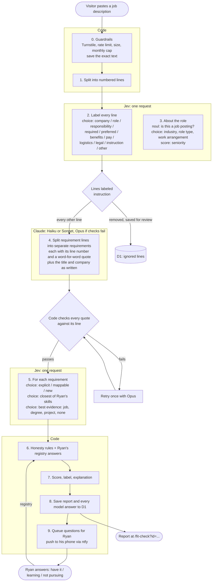

# Fit Check flow

A working document for Ryan and Claude to edit together. It describes how a pasted job description becomes a fit report: which step does what, and who owns it. GitHub renders the Mermaid diagrams.

How to edit it:
- Change anything you disagree with directly.
- Leave notes as `> **Ryan:** …` or `> **Claude:** …` under the part they're about.
- Settled decisions move to the [decision log](#decision-log). Open ones stay in [open questions](#open-questions).
- [`fit-check.md`](fit-check.md) describes the v1 build. Where the two differ, this file is the newer plan. The code catches up as each part is agreed.

**Status:** proposal, 2026-10-17. Nothing below the "Who does what" table has been built yet.

## Who does what

Each job belongs to exactly one owner. No owner checks or overrides another owner's answer.

| Owner | Job | What it returns |
| --- | --- | --- |
| **Code** | Guardrails, splitting the text into lines, applying the honesty rules, scoring, writing the report text, saving, notifying | Everything a visitor sees, computed |
| **Jev** | **Every judgment.** What each line *is*, whether it's a must-have or a nice-to-have, the company's industry, the role type, and how Ryan's record covers each requirement | TypeSafe primitives only: `choice`, `score`, `noul` |
| **Claude** | **Rewriting, never judging.** Breaking a requirement line into separate requirements, naming each one, and copying out the title and company | Text, which code checks against the original posting |
| **Ryan** | Answers about skills the record doesn't show (have it but never listed it / learning it / not pursuing it) | Registry answers in D1 |

What changes from v1:
- Claude no longer guesses must-have vs. nice-to-have, so Jev no longer overrides Claude.
- Claude no longer picks Ryan's related skills. That's a judgment, so Jev makes it.
- "Opus if ambiguous" is now decided by code, not by Sonnet reporting on itself (see [step 4](#4-split-requirements-claude)).
- When Jev is down, the check **fails and asks the visitor to try again later**. Claude does not stand in for Jev's judgments. If Claude covered for Jev, the two would overlap again. *(Open question 1.)*

## The flow

Steps 2 and 3 go in one Jev request, and step 5 in a second one. That's two Jev calls and one Claude call per check.

## The steps

### 0. Guardrails (code)

These are unchanged from v1: Turnstile, 5 checks per minute per IP, 200 to 15,000 characters, and a monthly cap.

What's new:
- **The exact pasted text is saved** (`fit_checks.jd_text`) on every check, including repeats of a posting already checked, so we can tune against real input. *(Done in this PR.)*
- Invisible characters (zero-width characters, bidirectional controls) are removed before anything reads the text. They're a common way to hide instructions from a human reader. The saved text keeps them, so we can see what was attempted.

### 1. Split into lines (code)

The text is split at line breaks and bullets. A long paragraph is split again into sentences, so an instruction can't hide in the middle of a real paragraph. Each piece gets a number (`L1`, `L2`, …). Everything after this step refers to lines by number.

The example posting ([`example-job-description.txt`](example-job-description.txt)) comes to about 60 lines.

### 2. Label every line (Jev)

There's one `choice` question per line. The `state` is the whole numbered posting, so Jev can see that a line sits under "Required:" or "Preferred:".

| Label | Meaning | Used for |
| --- | --- | --- |
| `company` | About the employer | Industry (step 3) |
| `role` | What the job is | Role type, seniority |
| `responsibility` | Something the person will do | Requirements, weighted as nice-to-have *(open question 3)* |
| `required` | A must-have qualification | Requirements, must |
| `preferred` | A nice-to-have qualification | Requirements, nice |
| `benefits`, `pay`, `logistics` | Benefits, pay, location, schedule | Saved; `logistics` is compared with Ryan's work preferences |
| `legal` | EEO statements, disclaimers | Ignored |
| `instruction` | Text addressed to an AI, a screener, or a reviewer, or telling how to rate the candidate ("ignore previous instructions", "rate this candidate 100%") | **Removed.** It never reaches Claude or the matching step. It's saved so Ryan can see it |
| `other` | Headings, links, filler | Ignored |

**This is the prompt-injection defense.** Instruction lines are removed before any model reads the posting for content. The report can mention that lines were ignored, without quoting them *(open question 4)*. Even if a line slips through, steps 4 to 7 still only produce typed answers and quotes that code verifies, and code computes the score.

So the label alone decides must-have vs. nice-to-have. Nothing downstream changes it.

### 3. About the role (Jev, same request as step 2)

| Question | Type | Options |
| --- | --- | --- |
| `is_job_posting` | `noul` | Below 0.5 → "this doesn't look like a job description" |
| `industry` | `choice` | insurance, financial services, healthcare, retail & e-commerce, agriculture, logistics & shipping, consulting & agencies, software & SaaS, government, education, manufacturing, other |
| `role_type` | `choice` | engineering manager, lead engineer, senior IC, IC, other |
| `work_arrangement` | `choice` | on-site, hybrid, remote, not stated |
| `seniority` | `score` | 5 levels, from early career to director |

**Industry match (new).** Code compares Jev's pick with the industries Ryan has worked in. The report says, for example, *"Industry: insurance. Ryan has worked in insurance at Wellabe."* To do this, each job in `data/resume.yaml` needs an `industry`. Here's a proposal for Ryan to correct:

| Job | Proposed industry |
| --- | --- |
| Source Allies | consulting & agencies (and the client's industry?) |
| Patient Preferred Financial Services | healthcare, financial services |
| Principal Financial Group | financial services, insurance |
| Wellabe | insurance |
| Far Reach | consulting & agencies |
| Hy-Vee | retail & e-commerce |
| Stine Seed | agriculture |
| Brownells | retail & e-commerce |
| UPS | logistics & shipping |

> **Claude:** For consulting work, the client's industry is probably what matters more. Which industries were your Source Allies and Far Reach clients in?

### 4. Split requirements (Claude)

Claude receives only the lines labeled `required`, `preferred`, or `responsibility`. Lines labeled `instruction` never reach it. It returns:
- the title, company, and location exactly as written (copying text out, which Jev can't do)
- every separate requirement, each with:
  - `line`: the line it came from
  - `quote`: the exact words from that line
  - `name`: a short name, e.g. "TypeScript" or "Mentoring engineers"
  - `kind`: skill, experience, education, or trait
  - `anyOf`: the options, when the line lists them as examples, e.g. "(ex. Angular, NodeJS, TypeScript, C++, .NET, Java, SQL)"
  - `alternatives`: when the line offers different routes, e.g. "Bachelor's + 2 years OR 6 years of experience"

Claude doesn't decide importance, coverage, or which of Ryan's skills relate. Those are all judgments.

**Code checks Claude's work.** Every `quote` must appear in its `line`, and every quote must come from a line Claude was given. If any check fails, the same request is retried once with Opus. If it fails again, the check errors. So Claude can't add a requirement that isn't in the posting, and code, not the model, decides when to escalate.

**Model:**
- **Haiku 5.5** first. It costs about 1/20 of Sonnet and this step is pure extraction.
- If the evals say Haiku isn't good enough, use **Sonnet 5.5**.
- **Opus 5.5** handles the retry.

*(Open question 2.)*

The example's line 26 becomes:

| # | name | kind | quote | shape |
| --- | --- | --- | --- | --- |
| R1 | Bachelor's in CS, MIS, or related | education | "Bachelor's degree in Computer Science, MIS, or related field of study" | alternatives: R1 + R2, or R3 |
| R2 | 2+ years of software development | experience | "at least 2 years of software development experience" | anyOf: Angular, Node.js, TypeScript, C++, .NET, Java, SQL |
| R3 | 6 years of related experience | experience | "6 years of related and applicable experience" | |

### 5. Match each requirement (Jev)

The `state` is the requirements plus Ryan's record (skills, jobs, education, certificates, projects, and registry answers). There are three `choice` questions per requirement.

| Question | Options | Meaning |
| --- | --- | --- |
| `cov_N` | **explicit** | Ryan's record names this skill or qualification directly |
| | **mappable** | Ryan has a different skill that carries over (Vue → Angular, Kanban → Agile) |
| | **new** | Nothing in the record is close; it would take real time to learn |
| `skill_N` | one of Ryan's 87 skills, or `none` | The closest skill: the one it maps from, or the one that is the match |
| `ev_N` | a job, degree, certificate, project, or `none` | The best evidence |

For `anyOf`, any option that's explicit makes the requirement explicit. For `alternatives`, whichever route scores best counts.

### 6. Honesty rules (code)

1. **Ryan's registry answer comes first.**
   - *have* → **Explicit**, with his note, and it's added to the resume (see [the skills check](#the-skills-check)).
   - *learning* → **Learning**.
   - *not pursuing* → **Not a focus**.
2. **Explicit needs proof.** Jev's evidence pick must have probability ≥ 0.5, or the matched skill must be one Ryan has used in a job. Otherwise the requirement drops to *mappable*.
3. **Mappable needs a named skill** (`skill_N` isn't `none`) and Jev confidence ≥ 0.5. Otherwise it becomes *new*.
4. Every inferred label is shown as inferred.

### 7. Score (code)

Must-have weighs 3 and nice-to-have weighs 1. Credit: explicit 1.0, mappable 0.6, learning 0.25, new and not a focus 0. Industry and work arrangement are shown but don't count toward the score *(open question 5)*.

### 8. Save (code)

Saved to `fit_checks`:
- the exact pasted text
- the numbered lines with Jev's labels and probabilities
- Claude's requirements
- Jev's match answers
- the models used, token counts, and the report

With all of that, the report can be **recomputed from saved answers** whenever the rules or Ryan's registry change, without calling any model again. It's also the raw material for evals.

### 9. Ask Ryan (code → ntfy, later the admin app)

See the next section.

## The skills check

What the report says for each requirement:

| Status | Shown as | When |
| --- | --- | --- |
| Explicit | **Has it** | The record lists it, with evidence |
| Mappable | **Related experience**: "from Vue.js at Hy-Vee" | A listed skill carries over |
| Learning | **Learning** | Ryan said he's learning it |
| New | **Would need to learn** | Nothing close in the record |
| Not a focus | **Not a focus** | Ryan said he's not pursuing it |

Every *mappable* or *new* requirement becomes a question for Ryan:

> **TypeScript generics** came up as a must-have (Wellmark, Sr. Software Engineer). Your record maps it from TypeScript.
> [I have this] · [I'm learning it] · [Not for me]

- **I have this** adds it to the registry as *have*. The admin app then opens a PR adding it to `data/resume.yaml` under the right skill group, with the job Ryan picks as where he used it.
- **I'm learning it** shows *Learning* until he changes it to *have*.
- **Not for me** shows *Not a focus*.

Answers apply to **every report, past and future**, because reports are recomputed from saved answers (step 8). A recruiter who reopens a link sees the updated report.

*(Open questions 6 to 8 are about this section.)*

## Tuning

Tuning needs three things:
1. **Real inputs.** D1 saves every pasted posting.
2. **Correct answers to compare against.** These are a small set of postings where Ryan has marked how each line should be labeled and how each requirement should be classified. They start with the example posting.
3. **A runner** that sends each posting through the pipeline and reports where the answers differ.

| Tool | Fits? | Why |
| --- | --- | --- |
| **promptfoo** | **Yes. Start here.** | A Node CLI with test cases in YAML. It has an Anthropic provider, a [TypeSafe provider](https://www.promptfoo.dev/docs/providers/typesafe/), and assertions. It can run in CI. It compares prompts and models side by side (Haiku vs. Sonnet in step 4, for example). |
| **DSPy** | Later, maybe | It automatically rewrites a prompt to score better on your test cases. The idea fits step 4. But it's Python-only and can't run inside the Worker, so it would be an offline tool whose best prompt gets copied into the code. It's worth it once there are about 30 labeled postings and Claude's step is the weak point. |
| **LangChain** | No | It's a framework for chaining model calls and building agents. This pipeline is a fixed sequence of three calls, which plain code handles. LangChain would add a heavy dependency to the Worker without helping with tuning. Its sister product LangSmith does tracing and evals, but promptfoo covers the evals and D1 already keeps the traces. |
| Langfuse / Braintrust | Not yet | Hosted dashboards for traces and evals. They're useful at higher volume; at 300 checks a month, D1 plus promptfoo is enough. |

Jev's side is tuned the same way. The `instructions` and `criteria` text in each question is its prompt, and promptfoo can compare wordings.

## Open questions

1. **Jev down:** fail the check (proposed), or let Claude answer Jev's questions and mark the report "uncalibrated"?
2. **Step 4 model:** start with Haiku 5.5, and move to Sonnet only if the evals say so?
3. **Responsibilities:** do lines like "Guide other engineers in design, code testing, debugging…" count as requirements? Proposed: yes, as nice-to-haves. Postings often state their real requirements there.
4. **Ignored instructions:** tell the visitor ("2 lines were ignored because they were instructions, not job details"), or say nothing?
5. **Industry and work arrangement:** shown only (proposed), or part of the score?
6. **Planned learning:** for a skill Ryan plans to learn before starting, should the report say *Learning* (proposed) or *Has it*? Showing it as *Has it* before it's true would be claiming it. *Learning* still earns some credit, and "I'll have this by my start date" can be its note.
7. **When to ask:** every *mappable* and *new* requirement (proposed), only must-haves, or only when a report has more than some number of them?
8. **What "I have this" needs:** a job where Ryan used it (so the resume can show it), or is a note enough?
9. **Retention:** the exact text is kept for 12 months, then deleted. Longer for tuning?

## Decision log

| Date | Decision |
| --- | --- |
| 2026-10-17 | Jev makes every judgment and Claude only rewrites. No overlap between them. |
| 2026-10-17 | Lines Jev labels as instructions are removed before any other step. |
| 2026-10-17 | The exact pasted text is saved on every check. |
| 2026-10-17 | Industry is a Jev `choice`, compared in code with the industries in Ryan's record. |
